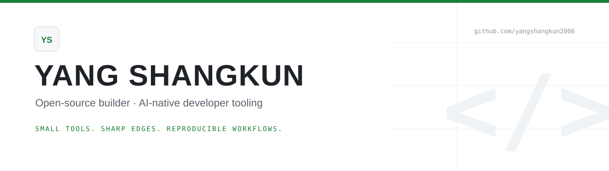

<picture>
  <source media="(prefers-color-scheme: dark)" srcset="assets/hero-dark.svg">
  <source media="(prefers-color-scheme: light)" srcset="assets/hero-light.svg">
  
</picture>

**Open-source builder · AI-native developer tooling**

> Small tools. Sharp edges. Reproducible workflows.

I build **small, sharp tools** for people who ship code with AI.  
Less magic, more reproducible workflows.  
Most AI tooling is demo-shaped; I care about what survives Monday.

---

## Now

- Exploring a **repo-readiness checker** for AI coding agents as the first tool.
- Writing build notes as I go.
- Open to collaborations on developer tooling and agent workflows.

**Exploring:** LLM agents · CLI design · developer experience

## How I work

- **Small over big.** One tool, one job.
- **Reproducible over impressive.** If it can't be rerun, it doesn't count.
- **Boring infrastructure, sharp tools.**
- **Write down what breaks.** Failure modes are part of the product.

## First project

No public repos yet. I'm scoping one narrow, annoying problem in AI-assisted development to turn into a small open-source tool.

Have one? [Open an issue](https://github.com/yangshangkun2006/yangshangkun2006/issues) and tell me what breaks.

## Build log

| Date | Note |
| --- | --- |
| 2026-10-19 | Profile v1. Scoping the first tool. |

## Connect

[Follow the build](https://github.com/yangshangkun2006) · [Open an issue](https://github.com/yangshangkun2006/yangshangkun2006/issues) · [Build log](#build-log)
